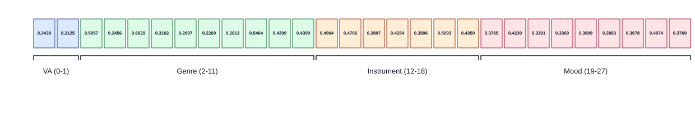
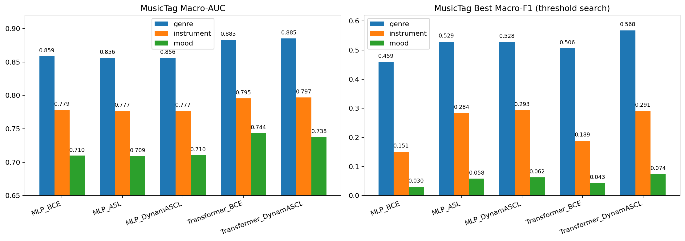
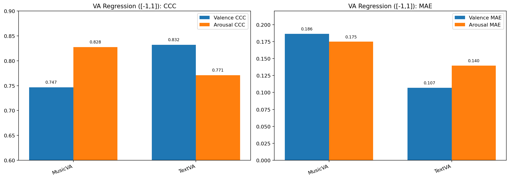

# EmoMusicRec

EmoMusicRec 是一个面向情绪调节场景的音乐检索系统：输入用户当前文本情绪与调节意图，输出更匹配目标情绪方向的音乐候选。系统采用“连续情绪空间（VA）+ 离散语义标签（Tag）”的白盒组合路径。

## 项目结构

```text
EmoMusicRec/
├─ configs/
├─ data/
│  ├─ Chinese+English/
│  ├─ DEAM+PMEMO/
│  ├─ MTG-Jamendo/
│  └─ music_db/
├─ outputs/
└─ src/
   ├─ application/
   ├─ eval/
   ├─ music_tag/
   ├─ music_va/
   └─ text_va/
```

## 三底座
| 模块 | 模型               | 损失 | 数据集                                         |
|:---:|:----------------:|:---:|:-------------------------------------------:|
| 文本 VA<br/>（`src/text_va`） | `XLMRobertaVA`   | `CCC + MSE` | Chinese(CAVS+CAVT)<br/>English(emobank+facebook) |
| 音乐 VA<br/>（`src/music_va`） | `MERT+MLP`       | `CCC + MSE` | DEAM + PMEmo                                |
| 音乐 Tag<br/>（`src/music_tag`） | `MERT+MLP/Transformer` | `BCE / ASL / DynamASCL`| MTG-Jamendo                                 |


## 音乐数据库（MTG-Jamendo）
示例：
```json
{
  "song_id": "track_0484375",
  "source": "jamendo",
  "song_path": "D:\\AAAA_audio_dataset\\mtg-jamendo\\audio\\75\\484375.mp3",
  "display_tags": ["electronic", "synthesizer", "dream"],
  "semantic_vector_28d": [
    0.3439, 0.2125, 0.5057, 0.2456, 0.6929, 0.3102, 0.2697, 0.2269,
    0.2013, 0.5464, 0.4399, 0.4399, 0.4904, 0.4706, 0.3807, 0.4254,
    0.3596, 0.5093, 0.4350, 0.3765, 0.4230, 0.3391, 0.3360, 0.3809,
    0.3883, 0.3678, 0.4074, 0.3769
  ]
}
```

 
 
## 核心引擎

| 步骤 | 输入 |                                                      公式                                                      | 作用 |
|:---:|:---:|:------------------------------------------------------------------------------------------------------------:|:---:|
| F1：文本情绪估计 | 用户文本 $t_q$ |                                         ${z}_q=f_{\text{text}}(t_q)$                                         | 得到当前情绪点 ${z}_q$ |
| F2：意图调节 | ${z}_q$ 与意图 $r$ |                                   ${\mu}_q={z}_q+{\Delta}_r({z}_q)$                                   | 得到目标情绪点 ${\mu}_q$ |
| F3：标签原型 | 语义库向量 ${s}_i=[{z}_i,{y}_i]$ |                               ${c}_j=\frac{\sum_i w_{ij}{z}_i}{\sum_i w_{ij}}$                               | 将标签映射到 VA 原型空间 |
| F4：目标偏好分布 | ${\mu}_q,{c}_j$ | $\tau_{q,j}=\frac{\exp(-\alpha\lVert{\mu}_q-{c}_j\rVert^2)}{\sum_k\exp(-\alpha\lVert{\mu}_q-{c}_k\rVert^2)}$ | 得到标签偏好分布 ${\tau}_q$ |
| F5：VA 约束重排 | ${\mu}_q,{\tau}_q,{s}_i$ | $S_i=\lambda_{\text{va}}{RankNorm}(-d_i^2)+\lambda_{\text{tag}}{RankNorm}({\tau}_q^\top{y}_i)$ | 输出 Top-K 结果（先 VA 后语义） |

## 实验结果

### MusicTag 不同（模型+损失）训练结果对比：


### Music和Text的VA 回归对比：

